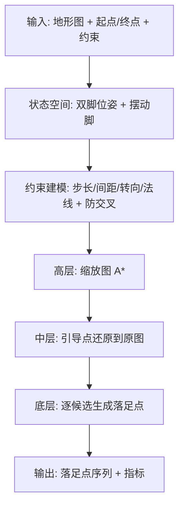

# 双足机器人路径规划：问题分析与方案设计

本文记录**建模推导**：问题怎么刻画、状态空间与约束怎么定义、为什么选分层 A*。
阈值与算法参数见 `doc/project.md`，模块与数据流见 `doc/architecture.md`，命令见 `readme.md`。

## 1. 问题分析

### 1.1 问题背景

双足机器人在复杂地形上行走时，须依据地形特征选择落足点，同时满足自身物理约束。
与轮式/履带式不同，它没有连续通行区域：每一步都必须落到满足**足底姿态**与**双足相对位置**
约束的具体点位上，所以规划产物是一串落足点，而不是一条曲线。

### 1.2 输入要素

- **地形图**：灰度高度栅格（`map.csv`，x=行、y=列）。
- **起点与终点**：二维投影坐标。
- **物理约束**：最大步长、双足间距区间、最大转向角、足部法线角度上限（数值唯一事实源：
  `crates/trapla-core/src/config.rs`）。

### 1.3 基本假设

1. 足部与地面接触发生偏转时，接触面积不变。
2. 足部正方向与移动方向一致；存在**激活步长**，只有达到激活步长时摆动脚正方向才改变。
3. 左右脚交替运动。
4. 腿长无限（不建模抬腿高度与关节可达性）。

### 1.4 核心概念

- **引导点**：寻路算法在缩放图上给出的、不直接作为落足点的路径点。
- **指向点**：由引导点序列算出的、用于确认移动方向的点（`astar::direction_determine` 的输出）。

### 1.5 关键挑战

1. **状态空间大**：每只脚有位置 `(x, y)` 与朝向 `rz`，且需记录当前摆动脚。
2. **多约束耦合**：步长、双足间距、转向角、足部法线角同时限制候选，可行集可能为空。
3. **地形适应**：需要按地形特征动态调整落足点，且陡峭区应影响路径选择而非只在最后过滤。
4. **实时性**：原图 1000×3000，必须在有限时间内给出解。

## 2. 解决方案设计

### 2.1 状态空间建模

用三元组 `(x, y, rz)` 定义一只脚的状态：

- `x, y`：脚在地面的投影坐标（浮点，候选点由几何构造给出）；
- `rz`：脚的朝向角（绕竖直轴）。

隐式计算属性：`z` 由地形高度查询得到；`rx, ry` 由接触平面法线与脚的姿态算出。
整套状态 = (左脚位姿, 右脚位姿, 当前摆动脚)。

### 2.2 约束条件建模

四条都是**硬约束**（候选过滤），不是软代价：

| 约束 | 判据 |
|---|---|
| 步长 | 移动距离 < 最大步长 |
| 双足间距 | 间距落在 `[min − 1e-3, max + 1e-3]`（闭区间；几何口径见 `doc/project.md`） |
| 转向角 | `|wrap(新朝向 − 支撑脚朝向)| < 最大转向角` |
| 足部法线角 | 覆盖格全部在图内、无障碍，且拟合平面法线角 < 上限 |

此外要求新位置不与支撑脚交叉（`will_feet_cross`）。

### 2.3 算法选择与设计

- **A\***：代价非负、欧氏距离启发式可采纳，能给出最优粗路径。
- **启发式**：A* 的距离启发式（到目标点的欧氏距离）。「方向一致性」与「落足点稳定度」**不作为
  启发式**：方向用于候选选优（指向点加权），稳定度是可站立的硬约束。
- **地形代价**：陡峭区块按 `PENALTY_K` 加权计入代价，使路线避开陡坎。

### 2.4 分层路径规划

| 层 | 输入 | 输出 | 关键点 |
|---|---|---|---|
| 高层 | 缩放图（`scale = 1/40`） | 引导点序列 | 降采样窗口均值；含障碍的窗口整格记障碍 |
| 中层 | 缩放区块 | 原图引导折线 | 区块 → 角点闭区间（`Grid::restore_block`） |
| 底层 | 引导折线 + 机器人状态 | 落足点序列 | 每步构造候选、过滤、防交叉、按指向选优 |

分层的收益：高层把搜索规模压到 1/1600，底层只在局部做几何检查。

### 2.5 足部姿态与接触平面

1. **覆盖区域**：足矩形按采样步长 0.5 扫描，四舍五入到整数格后去重，得到覆盖格集合。
2. **地面采样**：每格的 `(x, y, height)` 作为三维采样点。
3. **接触平面**：贪心 **up-fit**（迭代保证没有采样点落在返回平面上方）。
   不采用最小二乘；三点共线等退化输入返回 `DegeneratePlane`，不返回「平坦」的假平面。
4. **稳定性评估**：法线角与阈值比较，作为 `standable` 硬约束。
5. 接触面积比例、压力分布、摩擦系数、凸包支撑区域不在本规划器建模范围内。

### 2.6 算法流程

## 3. 当前状态

**已实现**：分层规划、四条约束的候选过滤、防交叉、指向加权、确定性随机源、猫步指标、
CSV/JSON 读写、CLI（`plan` / `analyze`）、Bevy 可视化、22 个函数级 golden 夹具对照。

**已知未完成**：走猫步的主判据未达标（`proper_crossings` 目标 0、实测 4；横向间距 min 目标 ≥ 3.0、
实测 0.82）。判据与方案见 `doc/catwalk_diagnosis.md`、`doc/catwalk_design.md`。

**未建模**（属在线执行层，不在本规划器范围）：观测噪声、足底打滑、动力学约束、能耗最优、
动态障碍与多机协调。
